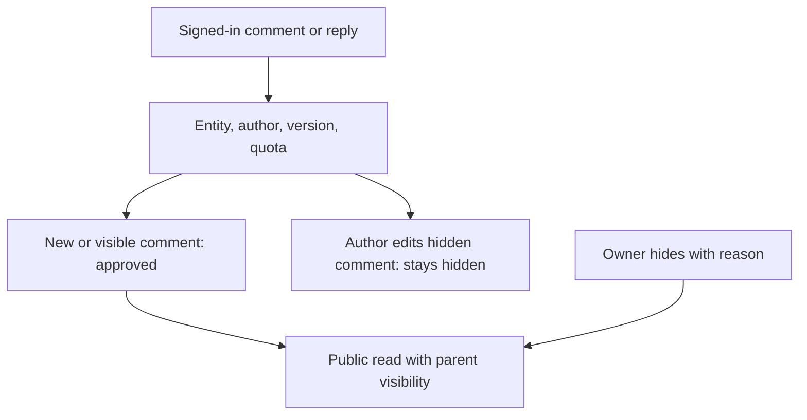

**Superseded in scoped part by ADR0019 (26 November 2026):** public comment surfaces also accept server-validated guests, with identity requested after commit. Existing publication/moderation/CAS/author-only and private-entity rules remain. See [ADR0019](0019-guest-social-interactions.md).

# ADR0014 — Immediate comments and a quieter Home

Date: 19 November 2026. Requested by the owner: comments no longer need approval before appearing. This supersedes the pending-on-create/edit comment behavior in ADR0002. Publication and request approval rules are unchanged.

Home retains its cover, owner composer and post feed. Remove the visible feed title, routine successful-load/profile-save messages, room cards and Help Shop promotional block. Keep errors and empty states. The sidebar still provides all room routes. A single Home discussion sits directly below “Để lại vài dòng cho Hiển”; the button expands the composer on the current page. Guests can read, and sign in in place to submit. Both locales use the canonical Home entity and the existing API/epoch.

Comments and replies use initials, author labels, timestamps, gray text bubbles, nested replies and a three-dot options menu. Editing/deletion is author-only; owner moderation remains available with a reason and version check. Emoji inserts plain text; this change does not add attachments, GIF uploads, reactions or account-profile collection. Existing API data only identifies authors by verified UUID or imported legacy login; initials and “Member” are intentional fallbacks.

Authenticated creates use `approved` immediately in `private.write_comment`. Edits to visible or pending comments remain/become approved. Edits to hidden/rejected comments by their author retain the moderation status so editing cannot defeat an owner's decision, including when the author is the owner. The owner can explicitly approve via moderation. Deleted comments remain deleted. No existing pending/hidden/rejected rows are bulk-published. Historical receipts, import records, schema/DTOs, one-level reply depth, entity visibility, author checks, quotas, admission, audit and CAS remain intact.

Apply the additive `20261119160000_immediate_comments.sql` migration to staging, verify it, then apply to production before publishing the UI. No Edge deployment or source switch is needed: the existing RPC signature/DTO stays compatible. No hosted test submissions. Local SQL/DOM tests do not establish hosted rollout or real OAuth/browser verification.

Rollback the UI independently if needed. To restore pre-review for future writes, deploy the previous `private.write_comment` definition from `202611150004_release_gates.sql`, retaining all later wrapper grants/admission controls. Already published comments require deliberate owner moderation; do not automatically hide data or replay old import/cutover SQL.
