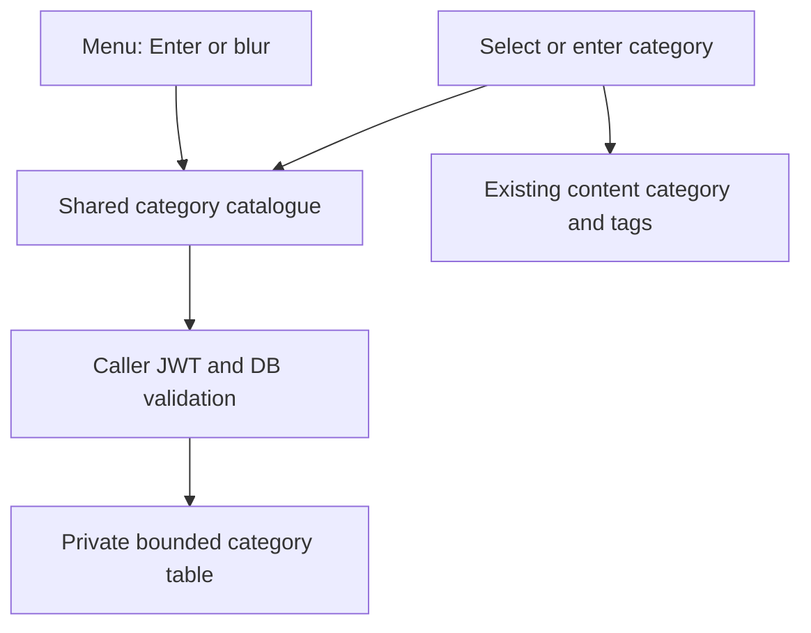

# ADR0015 — Navigation and shared content categories

19 November 2026. Requested by the site owner. The five primary destinations are Home, Photos, Video, Writing and About. Existing routes, imported novels, guestbook and Requests remain available through their original URLs and secondary links. Git operations are handled by the user in this session.

A bounded public catalogue in PostgreSQL supplies photo albums, media categories and writing categories. Category creation is an explicit public action available to verified signed-in members, including the owner; it does not change ownership, publishing or moderation rights. Anonymous visitors can read the catalogue. Names are plain text, 1–40 characters, whitespace-normalized, deduplicated case-insensitively within each scope. There are at most 100 categories per scope and 10 successful creations per actor/minute. Reads and writes use the existing shared admission boundary. Tables are private, RLS-enabled and inaccessible to clients; caller-JWT invoker RPCs expose only bounded label data. Draft publication categories are not harvested into this public catalogue.

The add row creates an input above its button. Enter or blur saves nonempty text once; Escape cancels. Failed saves retain the input for retry and do not create a fake menu node. Desktop and mobile menus and editable comboboxes share one catalogue. New user labels retain their original language. No category or credentials are cached in browser storage.

Album IDs extend the photo metadata schema compatibly; a custom album is a `cat-UUID`. Photo records may include tags; old records remain valid. Photo assets and metadata retain the existing owner-only Git upload transaction. The static build also discovers album IDs/labels from photo records, so a deployed photo never depends solely on the live catalogue to be visible.

Writing stores the chosen label in its existing category field and tags. Media retains the validated `music`/`video` transport category; the user's chosen folder is a tag. This preserves old DTOs and safe provider validation. Home photo attachments also expose an album selector and store its label as an ordinary post tag, without making private attachment bytes public or copying them into the gallery. Cover/avatar image selection has an album selector as well and reads only published gallery metadata.

Filtered publication lists preserve cursor pagination: users can request further pages if a page contains no matching item. Filtering never fetches private content or broadens API visibility. Default writing destinations retain authored Projects/Series/Novels and additionally show matching published community posts.

Apply `20261119170000_content_categories.sql` before shipping the new client. Old clients remain compatible. Source preparation/tests do not establish a hosted rollout. On unavailable catalogue reads the static defaults remain usable; category writes fail visibly. Roll back UI independently, retaining new category/photo metadata; never drop data automatically.

