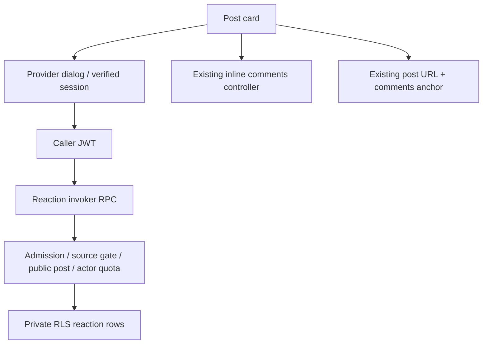

**Scoped amendment — ADR0019 (26 November 2026):** Auth-issued guests may comment/react on the requested public surfaces without manual sign-in. Post-commit identity choice, proof-based OAuth transfer, one reaction popup and public display-only paginated details supersede the corresponding restrictions below. Verified session retention remains; guest credentials use same-tab sessionStorage. See [ADR0019](0019-guest-social-interactions.md) and [verification](../project/guest-social-checkpoint-2026-11-26.md).

# ADR0016 — Inline post interactions and remembered sign-in

Accepted 20 November 2026 for the owner's request in this chat. Supersedes ADR0013's seven-day browser retention limit only. Persist the scoped Supabase session until device logout, browser removal or server revocation; refresh does not require another provider login. Provider tokens and PKCE verifiers remain memory-only, and `/me` must verify identity/role before private actions. Old unexpired v1 session envelopes migrate to v2; expired/corrupt records are discarded. No promise of an irrevocable or literally permanent server session.

Home post cards have Heart, Laugh and Wow, inline comments, and a copy-link action. Anonymous interaction opens a provider chooser; comments may be read inline while login is offered. Only authenticated users write. Each account has at most one reaction per public post; setting a value (or null to remove) is idempotent, never a server toggle. Counts expose no other reactor identities. Draft/deleted/unpublished posts are excluded, even for owner reaction reads/writes. Existing private-comment authority is unchanged. A shared batched read (max 50 post IDs), private RLS table, caller-JWT invoker RPCs and existing shared admission/write gates keep data/domain authority outside UI. No service-role browser client, new host, source/epoch change or role assignment.

The post interaction chooser offers GitHub, Google and Facebook through the existing same-origin PKCE popup callback. Provider availability comes from the public Auth settings endpoint. Disabled providers are labelled unavailable, never presented as working. Google/Facebook need owner-controlled OAuth app credentials configured in Supabase; credentials must not enter Git, chat or logs. Existing account sign-in retains its direct GitHub button. The chooser controller stays in the publications entry so unrelated routes do not pay its JavaScript cost.

Comment controllers are mounted lazily from the existing Astro template, with unique form IDs and cleanup on card removal/navigation. Expanded threads survive auth refresh, so provider login does not navigate away. Share copies the locale/base-aware existing post URL plus `#post-comments`; unavailable clipboard shows a selectable link. The existing detail route remains available.

Deploy the additive reaction migration to staging then production before frontend rollout. No hosted test submissions. Rollback frontend independently; retain reaction rows and session compatibility. Browser stubs/PGlite verify contracts, not real OAuth, real JWT authority or hosted performance. Record verification and any provider/deployment limits in project docs.
