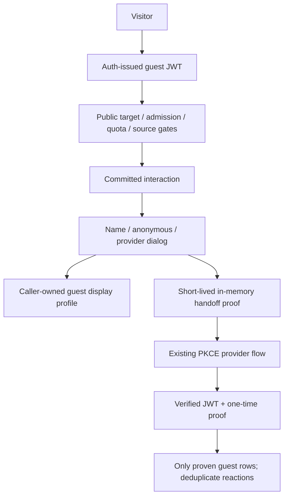

# ADR0019 — Guest social interactions

26 November 2026. Requested scope supersedes ADR0014/0016's sign-in requirement for existing public comment surfaces and Home post reactions only. Implementation candidate; no hosted rollout implied.

Use Supabase Anonymous Auth: Auth issues the JWT and database `auth.uid()` remains the only actor source. Anonymous users share the authenticated SQL role, so database checks explicitly deny publication, Requests, category creation and owner authority. Storage remains owner-only. Guest comment writes additionally require a public entity, and retain validation, moderation, CAS, quotas, admission and retry receipts. No raw anon-role writes are granted.

Guest scoped sessions use sessionStorage (same-tab reload/navigation); verified account sessions retain ADR0016 localStorage behavior. Only sanitized Supabase sessions may persist; provider tokens, PKCE verifiers and OAuth handoff proofs stay in memory. A server guest-profile record remembers the named/anonymous choice. The identity dialog opens only after the first successful interaction; cancellation sets the anonymous choice without deleting anything.

Before OAuth, a guest creates a short-lived single-use hashed handoff proof under its verified JWT. After normal PKCE OAuth, a verified account redeems that proof. The server infers both actors, transfers only that guest's comments/reactions, keeps existing destination reactions on conflicts, preserves historical revisions/audits, and disables further writes by the transferred guest. Repeat redemption is idempotent only for the same destination. No user/interaction IDs are accepted for claiming. Failed/canceled OAuth restores the original session; reload loses the in-memory proof and leaves original guest interactions intact. A new attempt creates a fresh proof. This handles existing provider accounts without relying on manual identity linking.

Names are presentation data, never roles. Public reaction details expose only a bounded page of name/avatar/reaction and an opaque positional cursor; no actor IDs, emails, credentials or tokens. Only published, undeleted public posts qualify. Laugh remains the stored value for Smile.

Deploy additive SQL and Edge changes to staging before frontend. Enabling Anonymous Auth and Google/Facebook requires separate environment configuration; production settings/migration/merge require owner approval. Preserve data on rollback: revert frontend first, disable anonymous signup to stop new guests if needed, retain rows/functions and source/epoch gates. Never replay old migrations or delete anonymous Auth users with authored rows. See the project checkpoint for actual evidence and outstanding release gates.
