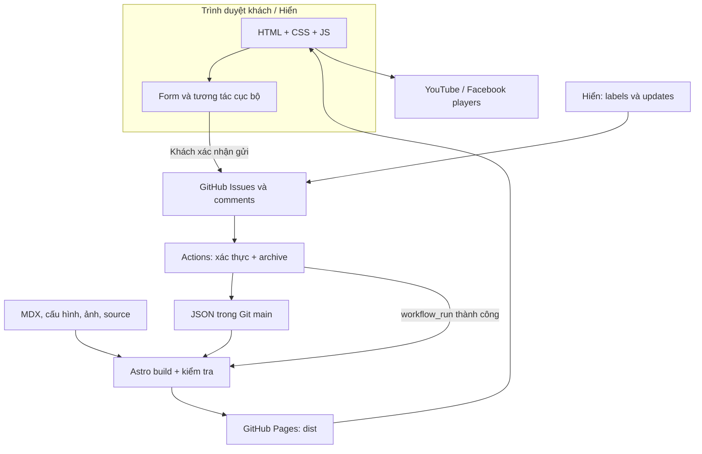
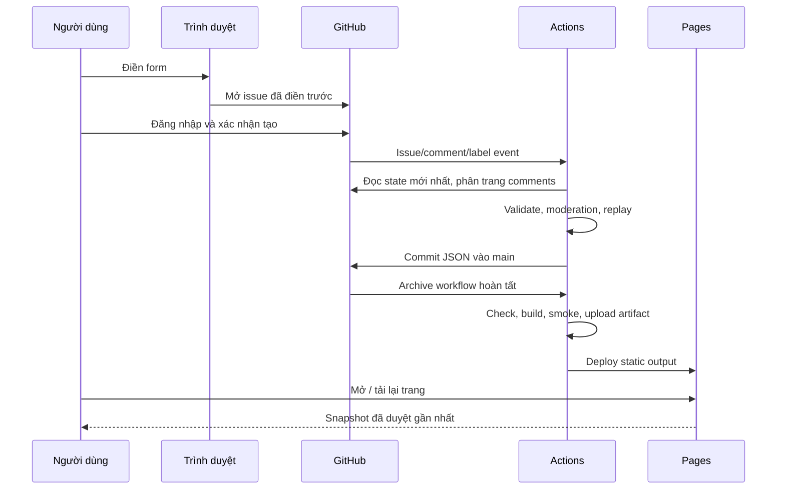
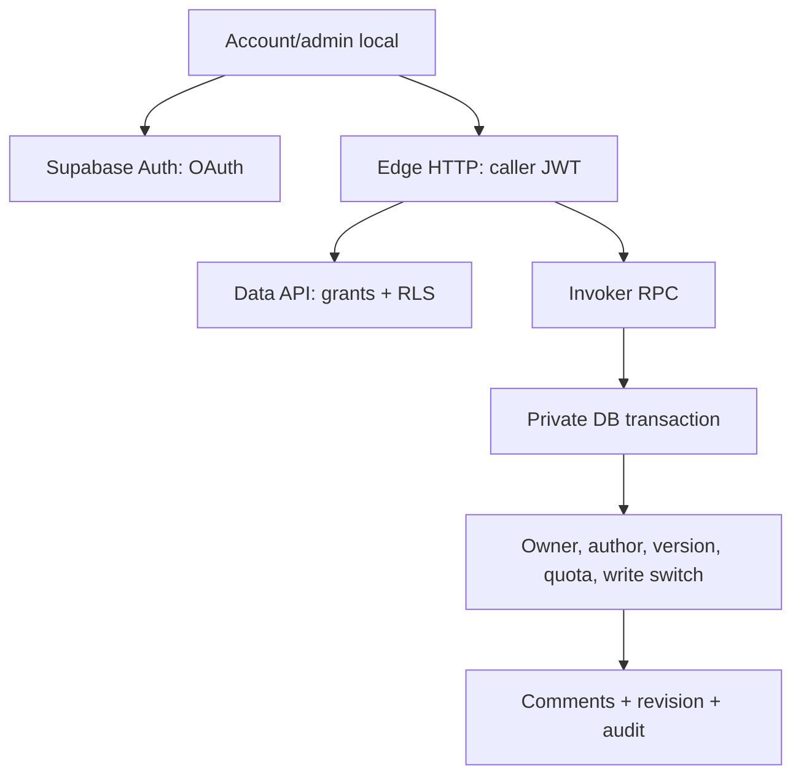

# Kiến trúc hiện tại và sơ đồ

## Quyết định triển khai

Source hiện tại dùng Astro 7.4.12 static + TypeScript + MDX 8.1.6, Tailwind/CSS, Pagefind, GitHub Actions và GitHub Pages, đã qua local/CI. Nội dung production tiếp tục dùng Git/Issues cho tới khi import và cutover từng feature. Source code backend được phép merge không tự bật nguồn ghi API. Supabase Free Singapore `eqxlywwvchmzuyqtxexu` đã được provision ngày 15/11/2026 với PostgreSQL/RLS và Edge API shadow; mọi source DB vẫn Git/epoch0/writes=false, đã nhập shadow6 bản ghi legacy, chưa cutover nội dung. GitHub provider/callback VI–EN và Pages login đã cấu hình; đăng nhập member và danh tính GitHub đã kiểm chứng trên website thật; owner duy nhất đã cấp theo phê duyệt rõ tài khoản/phạm vi và được API/UI xác minh. Nội dung vẫn dùng Git theo sơ đồ bên dưới. Không tạo Storage bucket hoặc service trả lời tự động. Functions trong `scripts/` là batch worker chạy trong Actions, không phải endpoint HTTP cho khách.

Luồng owner upload ảnh khác: trình duyệt Hiển dùng fine-grained GitHub token do Hiển nhập tại máy mình, tạo asset + metadata trong một commit. Token chỉ ở memory, không dùng cho visitors và không được gửi vào issue/archive/log. Source commit chạy Pages như bình thường. Ảnh Home cần featuredOrder; thêm file asset riêng lẻ không đủ.

## Luồng ghi và đọc dữ liệu

Archive dùng `GITHUB_TOKEN` nên commit từ workflow không được dựa duy nhất vào push trigger. `deploy-pages.yml` còn nghe **workflow_run của đúng tên `Archive guestbook`** và chỉ deploy khi workflow đó thành công. Đây là coupling có chủ đích, phải sửa đồng thời nếu đổi tên. Các issue khác nhau ghi file khác nhau; commit step rebase + retry để giảm xung đột. Đây không phải transaction DB, GitHub Actions concurrency không phải hàng đợi lưu toàn bộ mọi trạng thái trung gian. Luôn đồng bộ state mới nhất nên website có thể bỏ qua trạng thái trung gian bị sửa trước khi snapshot.

## Ranh giới các layer

| Layer | File chính | Được làm gì / không được làm gì |
| --- | --- | --- |
| Presentation | `src/pages`, `src/components`, `src/layouts` | Render escaped text, accessibility, dùng URL utilities; không tự quyết định approval/transition |
| Domain | `src/lib/requests.mjs`, `knowledge-submissions.mjs`, `media-links.mjs`, `photo-record.ts` | Validate và business thuần; không gọi GitHub, không chứa token |
| Read model | `request-data.ts`, `guestbook.ts`, `media.ts`, `shared-knowledge.ts`, `photos.ts`, content queries | Chọn published data lúc build; không ghi file hoặc làm mutation |
| Integration | `scripts/archive-*.mjs`, `photo-upload.ts` | GitHub I/O, dữ liệu đầu vào/đầu ra xác định; không nới quyền để “sửa nhanh” |
| Delivery | `.github/workflows`, `astro.config.mjs`, `site-settings.mjs` | CI, archive, Pages/base; không nhét business transition vào YAML |

Không gom các marker/schema khác nhau thành một parser “generic” nếu chưa có test compatibility. Tái sử dụng validator/tag helper là tốt; thay đổi schema v1 âm thầm làm hỏng archive cũ là không hợp lệ.

## Bốn đường nội dung

| Kho | Người ghi | Consumer | Phạm vi |
| --- | --- | --- | --- |
| `src/content` | Tác giả/reviewer qua Git | Astro collections + queries + graph | MDX có thể chứa component: chỉ source tin cậy |
| `data/guestbook`, `media`, `knowledge`, `requests` | Archive worker | Published read models | Dữ liệu text từ Issues, escaped; từng feature có approval riêng |
| `src/data/photos` + `src/assets` | Owner uploader hoặc Git thủ công | Photos model | Schema, file reference, metadata, featuredOrder |
| `src/data/music-performances.json` | Hiển qua Git | Music page | Video biểu diễn cá nhân, tách khỏi link cộng đồng |

## Tin cậy và bảo vệ business

- Không tin form client: validate lại trong worker và tại read model phù hợp. UI validation để giúp nhập liệu, không phải cấp quyền.
- Chỉ token Actions ở worker; visitors xác nhận ở GitHub. Không nhúng credential vào website static.
- Nhờ vả: so sánh login owner từ repository; visitor tự ghi marker trong comment không đổi được state. Labels do người có quyền GitHub điều khiển. Người có quyền sửa main vẫn có quyền sửa canonical data; code không thể bảo vệ trước chính quản trị repository ác ý.
- Guestbook vẫn dùng trusted replies OWNER/MEMBER/COLLABORATOR theo contract cũ; không mở rộng quyền tác nghiệp Requests theo cơ chế đó.
- Media URL kiểm tra HTTPS, host chính xác, video ID/path. Player URL dựng nội bộ, không render HTML nhận từ issue. Nền tảng có thể từ chối nhúng video riêng tư/không cấp quyền.
- LocalStorage chỉ dùng preference menu; không lưu token ảnh. Native details/dialog và link gốc giữ khả năng sử dụng khi JS thiếu.

## Bilingual và base path

`site-settings.mjs` sinh repository/base, `src/utils/url.ts` dựng URL, `i18n.ts` xác định locale, middleware `localize-html.ts` xử lý UI. `src/pages/en/[...path].astro` tái sử dụng view và enumerate routes. Khi thêm dynamic route VI phải enumerate EN tương ứng; không copy text authored thành bản dịch giả. `data-original-content` bảo vệ vùng nội dung gốc khỏi dịch UI. Base `/hiens-nha/` phải có ở internal links/assets; không hardcode đường root `/requests/` trong markup final.

## Mở rộng backend trong tương lai

Production chưa dùng backend; implementation local/CI được mô tả ở các mục sau và progress. Nếu cần ẩn danh, dữ liệu riêng tư, upload nhiều người hoặc realtime: thiết kế ADR mới về authentication, authorization theo owner/visitor, DB schema, object storage, moderation, rate limiting, backup và hosting. Giữ issue number/version hoặc có bảng mapping khi migrate; có export/import và rollback. Không thêm secret vào client để biến static site thành backend.

## Foundation backend riêng trong local (14/11/2026)

Production vẫn theo sơ đồ Git/Issues ở trên. [ADR 0001](../decisions/0001-backend-foundation.md) chấp nhận Phase 0–1: `supabase/` chứa local config, migrations/RLS/RPC và Edge HTTP; `src/lib/api`/`auth` là adapter dùng chung cho các shell account/admin VI/EN. Mặc định frontend tắt backend và DB tắt comment writes. Tại mốc foundation chưa có composer; Phase 2 local đã bổ sung UI/import rehearsal như phần bên dưới. Không có API cutover, cloud project hoặc writer thứ hai cho dữ liệu production. Xem [cách chạy local](backend-local.md), [OpenAPI](../api/backend-v1.openapi.json) và [tiến độ kiểm chứng](backend-progress.md).

Role không lấy từ metadata tự khai; browser chỉ đọc public config. Owner cấp bằng operator SQL sau khi xác minh auth UUID. Browser auth dùng PKCE popup để session/verifier ở memory; theo ADR0007 đang bổ sung ClientRouter để giữ phiên khi chuyển trang nội bộ cùng tab; reload/tab mới vẫn phải đăng nhập lại. Đây là giới hạn foundation đã chọn, chưa phải persistent login hoàn chỉnh. Các kiểm thử PostgreSQL nhúng không thay thế real JWT/PostgREST/OAuth/full-stack tests.

## Comments pilot trong local (Phase 2)

Production vẫn Git mode theo `config/comments-source.json`. Local `api-local` chỉ chấp nhận backend loopback. API mode render composer/thread/replies, own-pending/edit/delete và Sổ lưu bút tổng hợp từ DB; trang admin có hàng đợi duyệt owner-only. Các feature media/knowledge/requests giữ nguyên writer. Epoch và DB write switch phải khớp trước thao tác ghi; không fallback âm thầm sang snapshot Git khi API lỗi.

Một Auth runtime dùng chung trong trang, SDK chỉ tải khi đăng nhập, session/verifier vẫn ở memory. Trả lời một cấp có pagination riêng; `view=mine` cho phép quản lý câu trả lời của mình kể cả khi root bị ẩn. Đăng xuất xóa pending UI và response cũ bị bỏ qua. Text được gán bằng textContent, không chạy HTML/MDX.

Import local giữ raw provenance ở private schema, author_id=null cho tài khoản cũ chưa xác minh; không nhận ownership theo login. Operator import chỉ khi source Git và API writes đã khóa, sau đó shadow compare bằng anon RLS. [ADR 0002](../decisions/0002-comments-local-pilot.md) ghi source/budget/gates; [runbook](backend-local.md) ghi các bước rehearsal. Đây chưa phải feature đã bật trên Pages.

## Publications/Requests pilot (Phase 3/4, local only)

[ADR 0003](../decisions/0003-publications-requests-local.md) chốt typed private publications/revisions (working/published pointers), category/tag registries, author-scoped series slots và requests/scope revisions/immutable events. Public wrappers invoker gọi transaction functions với caller JWT, không dùng service-role cho CRUD. Bảng mới RLS deny-first/no direct table grants. Entity và comment visibility theo publication/request đã liên kết. Shared domain validators dùng cùng module portable cho Astro/Node/Deno; DB kiểm tra lại constraints/authority khi bypass Edge.

VI/EN tái sử dụng editor, API board/detail và admin panels. Static query shells resolve UUID, legacy request routes resolve number mapping; không tạo dynamic path tùy ý trên Pages. Source markers tách posts/media/requests, Git/epoch 0 mặc định; chỉ loopback rehearsal override API. Archive adapters skip đúng feature sau một cutover được duyệt. Requests importer chỉ local, idempotent và fail khi snapshot delta chưa review; giữ entity của discussion cũ và không claim legacy author. Production vẫn Git theo phần hiện trạng ở trên; full import/backup/restore/search và cloud release là Phase 5.

## Release rehearsal (Phase 5, local/CI)

[ADR 0004](../decisions/0004-release-rehearsal.md) và [release runbook](backend-release.md) bổ sung imports toàn bộ submission snapshots, private legacy series/tombstones, source control audit, SHARE-locked mutation gates, maintenance/rollback checks, native application/Auth restore và mixed load/cleanup. JSON transport adapter giữ kiểu object giữa PGlite và postgres.js; provenance có object constraints/backfill. Runtime logs chỉ có request ID/template/duration/status/code; worker connection bound không thay global IP ingress controls. CI backend changes chạy profile tải đầy đủ; docs/UI-only chạy profile ngắn cùng restore/permission/browser gates. [Kết quả](backend-benchmark-2026-11-15.json) là loopback CI, không phải đo production/Vietnam. OAuth/cloud/global abuse/offsite/hosted restore và actual cutovers còn mở.
