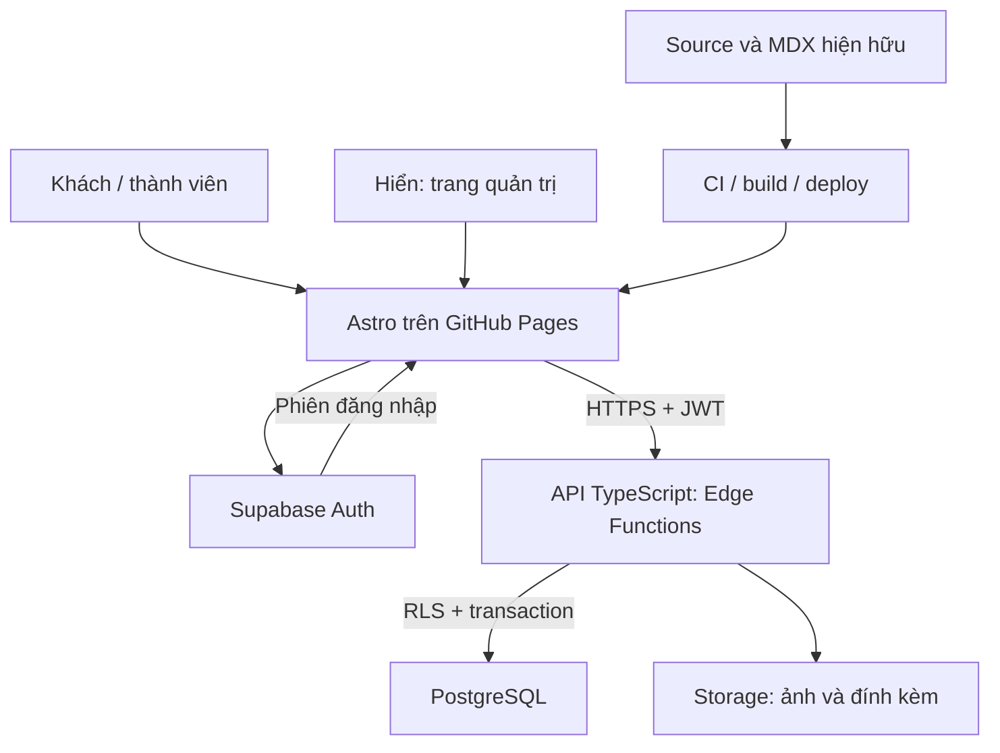
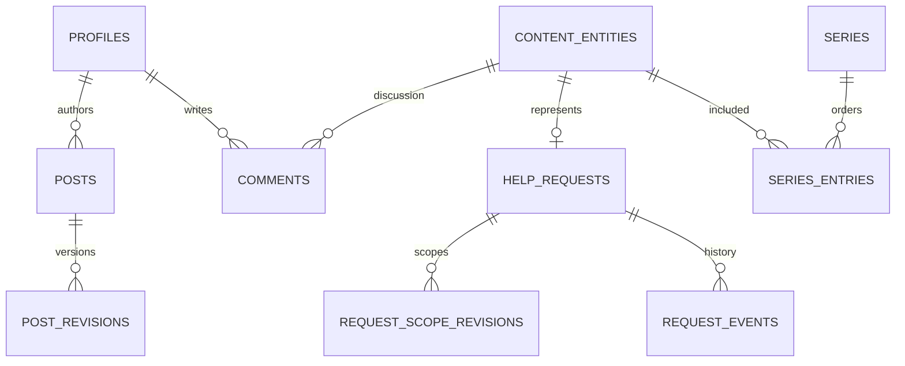

# Kế hoạch Backend API + DB cho Hien’s Nha

**Trạng thái: ĐỀ XUẤT — chưa triển khai, chưa tạo tài nguyên cloud, chưa phát sinh subscription.**
Ngày lập: 13/11/2026. Hiện trạng vẫn theo [architecture.md](architecture.md). Kế hoạch này không tự thay thế contracts hiện hành; các thay đổi quyền/publication phải được duyệt thành quyết định triển khai trước khi cutover.

## 1. Mục tiêu và lựa chọn

Mục tiêu: người dùng đăng nhập, thêm/sửa nội dung của mình trên website; Hiển quản trị và duyệt tại `/admin/`; bình luận, bài chia sẻ, link video và trạng thái nhờ vả được lưu DB và đọc ngay qua API, không chờ GitHub Actions. “Lưu ngay” không đồng nghĩa “công khai ngay”: tác giả thấy pending ngay, mọi người thấy sau khi duyệt. Các tab khác cập nhật khi refetch; realtime push là bước sau.

Đề xuất giữ Astro/TypeScript, HTML/CSS và GitHub Pages cho giao diện. Thêm **Supabase managed** làm PostgreSQL + Auth + Storage + Edge Functions TypeScript (runtime Deno). Chọn Singapore nếu có tại thời điểm tạo project, gần nhóm người dùng Việt Nam; đo độ trễ trước production. Không cần máy Windows, VPS tự quản hay rewrite thành Next.js/mobile app để đạt V1.

| Lựa chọn | Phù hợp | Đánh đổi |
| --- | --- | --- |
| Supabase Auth/Postgres/Storage/Edge Functions | Đề xuất cho V1, ít thành phần cần vận hành, SQL quen thuộc với anh | Học RLS và Deno/Edge limits; local stack thường cần Docker; backend có phần phụ thuộc provider |
| Node.js/Fastify hoặc ASP.NET Core + managed PostgreSQL | Khi cần backend truyền thống, job dài, nhiều tích hợp hoặc ưu tiên C# | Thêm server host, authentication integration, deploy/monitor và chi phí cần đánh giá riêng |
| Cloudflare Workers + D1/R2 + dịch vụ auth | Khi đã chọn Cloudflare và ưu tiên hệ sinh thái này | D1 dùng SQLite semantics thay PostgreSQL; cần ghép auth và thiết kế lại các phần SQL/RLS tương ứng |

Đây là đánh giá thiết kế cho dự án này, không khẳng định một stack tốt nhất mọi trường hợp. Không ghép thêm Redis/Kafka/microservices trong V1. Tách business khỏi SDK để có thể chuyển API runtime/DB host sau này.

## 2. Hosting và luồng xử lý đề xuất

API endpoint dự kiến: `<project-url>/functions/v1/api/v1/...`; frontend chỉ biết API base và publishable key. Đây là placeholder, chưa có project URL thật. Project DB/Auth/Storage ở region đã chọn; Edge Functions chạy theo cơ chế của provider, cân nhắc regional invocation gần DB cho nghiệp vụ nhiều truy vấn.

- **Đổi code/giao diện:** vẫn build/deploy.
- **Bình luận, bài/link mới, duyệt, trạng thái yêu cầu:** API → DB transaction → trả state mới → UI refresh ngay, không deploy.
- **Trang đang mở ở máy khác:** V1 refetch khi mở/focus hoặc bấm tải lại; Realtime subscriptions giới hạn theo scope ở V1.1.
- **MDX và 84 chương cũ:** tiếp tục static; chỉnh trực tiếp source vẫn cần build. Muốn quản lý chúng trong admin phải import và đổi nguồn đọc theo từng batch; không hứa toàn bộ nội dung động từ ngày đầu.

## 3. Chức năng và phạm vi

### V1 bắt buộc

1. **Đăng nhập và hồ sơ:** GitHub OAuth trước để tương thích người dùng cũ; Google thêm trước public beta nếu nhóm người dùng cần. Không yêu cầu họ biết GitHub Issues để dùng website. Chưa bật gửi ẩn danh. Chọn provider identity ổn định, không lấy display name/email do client tự gửi làm bằng chứng sở hữu.
2. **Bình luận:** nhập ngay tại trang; danh sách phân trang; trả lời một cấp; sửa/xóa mềm của chính mình; trạng thái pending/approved/rejected/hidden, báo lỗi rõ ràng. Hiển quản lý chung trong admin. Pending của tác giả được thấy riêng, không lộ qua public API.
3. **Bài viết/ghi chú/thơ:** editor văn bản/Markdown an toàn, preview, bản nháp và autosave, type/category/tags/series/order, lịch sử revision. Thành viên quản lý bài của mình; Hiển duyệt/xuất bản. Thơ giữ xuống dòng. Không chạy MDX/JS từ nội dung người dùng.
4. **Music & Video:** thêm/sửa link đã validate, tags/category/description, player preview, moderation, sửa link hỏng trong admin. Lưu provider + canonical URL/video ID nếu xác định được, giữ source URL. Không nhận raw iframe/SDK/HTML từ khách.
5. **Tiệm Nhờ Vả:** form và board dùng API, người gửi xem/trao đổi yêu cầu của mình; Hiển nhận việc, cập nhật tiến độ/result. Giữ nguyên transition rules, completed cần result, đổi phạm vi cần xem xét/nhận lại, approval khác acceptance.
6. **Admin:** hàng đợi duyệt, lọc/tìm kiếm, sửa metadata, ẩn/khôi phục, nhật ký người sửa và lý do. V1 chưa bulk delete; bulk approve có preview khi thực sự cần.
7. **Vận hành:** migrations, RLS, audit log, backup/restore thử được, logs có request ID, cảnh báo lỗi/quota và kill switch cho mutation.

### Sau V1, theo giá trị thực tế

| Ưu tiên | Feature | Giá trị / ràng buộc |
| --- | --- | --- |
| P1 | “Nội dung của tôi” + thông báo trong web | Biết bài đang chờ duyệt, ai trả lời, yêu cầu tới đâu; có bảng outbox để retry an toàn |
| P1 | Upload ảnh ngay trong admin | Album/description/featuredOrder; không phải nhập GitHub token. Giữ dialog fit/1:1 và 4/2/1 grid hiện tại |
| P1 | Tìm kiếm DB + lọc tag/category/series | Nội dung mới tìm được ngay; search Pagefind cũ không tự cập nhật khi DB đổi |
| P2 | Lưu yêu thích, theo dõi chuỗi thơ | Người đọc quay lại, nhẹ hơn xây social network |
| P2 | Email theo dõi nhờ vả | Opt-in, unsubscribe, outbox/retry, SMTP/API provider và ngân sách riêng |
| P2 | Realtime tiến độ/bình luận | Chỉ khi cần nhiều người mở cùng lúc; unsubscribe và quota theo scope |
| P3 | PWA, ghi âm → bản nháp, AI gợi ý tag/tóm tắt | Hữu ích sau khi CRUD ổn định; AI không tự publish hoặc nhận việc thay Hiển |

Chưa làm V1: marketplace nhiều người nhận việc, payment, chat realtime toàn diện, anonymous upload, stream/transcode video, tự động crawl/embed URL bất kỳ. Backend không vượt được quyền xem/copyright/embedding restriction của Facebook/YouTube.

## 4. Quyền và business contracts

| Vai trò | Quyền |
| --- | --- |
| Visitor chưa đăng nhập | Chỉ đọc revision đã publish và bình luận approved/public requests |
| Member | Tạo draft/submission; đọc pending của mình; sửa/xóa mềm nội dung của mình; không tự duyệt hoặc đổi trạng thái việc |
| Moderator (chưa cấp mặc định V1) | Có thể duyệt nội dung theo scope được giao; không vận hành nhờ vả hoặc đổi role |
| Owner: Hiển | Quản trị nội dung, duyệt, chuyển trạng thái nhờ vả, kết quả và bootstrap role có kiểm soát |

Role lưu ở bảng server-managed/verified app claims, không tin `user_metadata` hoặc `role` trong request. Cấp role không qua form signup. Việc thêm moderator sau này không mặc nhiên cấp quyền người nhận việc. Chọn owner bằng auth UUID đã xác minh, không bằng so sánh chuỗi tên hiển thị.

**Mặc định đề xuất:** thành viên mới phải duyệt nội dung. Hiển có thể publish nội dung của mình ngay. Bài/link đã published khi sửa tạo pending revision mới; public vẫn đọc revision đã duyệt trước, admin có thể unpublish ngay nếu cần. Bình luận đã duyệt khi người dùng sửa quay về pending và tạm ẩn để tránh thay nội dung sau duyệt. Đây là contract mới cần ghi rõ trước cutover vì archive cũ tự phản ánh sửa issue đã được approved.

Requests: tạo/sửa scope và chuyển trạng thái đi qua atomic DB function; optimistic version lock, expected revision và event history. Nếu owner vừa complete trên revision cũ trong lúc requester sửa scope, một transaction phải nhận conflict 409; không có trạng thái completed cho scope chưa được nhận. Mốc quyền/phiên bản phải kiểm tra trong DB, không chỉ trước transaction ở UI. Sau cutover dùng state events bất biến + correction event; không replay comment đã chỉnh sửa để thay lịch sử tác nghiệp. Giữ dữ liệu replay cũ trong lịch sử import, không diễn giải lại thành commit mới.

Canonical discussion identity dùng `content_entities.id`, độc lập VI/EN. MDX cũ được đăng ký entity bằng collection + ID chuẩn; API không nhận URL tùy ý làm quyền sở hữu. Chuẩn hóa context theo helper hiện hành để VI/EN/trailing slash không sinh hai thread. Public requests vẫn cần approval; yêu cầu chưa public chỉ tác giả/owner đọc. Dữ liệu đã công khai trong GitHub lịch sử không trở thành bí mật chỉ vì chuyển vào DB.

## 5. Mô hình dữ liệu dự kiến

| Nhóm bảng | Vai trò / constraints chính |
| --- | --- |
| `profiles`, `role_assignments` | FK auth user; owner role chỉ server cấp; profile công khai tách dữ liệu tài khoản |
| `content_entities`, `legacy_mappings` | Stable UUID cho MDX, post, media, photo, request; unique legacy key; route aliases; discussion identity |
| `posts`, `post_revisions` | published_revision_id khác working revision; revision/version; kind enum; soft-delete; Markdown không thực thi |
| `categories`, `tags`, `entity_tags` | ID ổn định; normalized label + display label; unique trong scope; không trộn domain enum với tags |
| `series`, `series_entries` | Numeric order + constraint trong series; explicit mapping tên shared series cũ; tránh merge nhầm series người khác cùng tên |
| `comments`, `comment_revisions` | entity_id FK, author_id, parent_id cùng entity, depth giới hạn một cấp, moderation/version, soft-delete |
| `media_links`, `media_revisions` | provider, source_url, canonical_url, category music/video, description; reused validation |
| `help_requests`, `request_scope_revisions`, `request_events` | public flag/moderation tách operational status; accepted scope revision; transition/result constraints; owner actor |
| `file_assets`, `albums`, `photo_entries` | Storage object key + owner + MIME/size/checksum, visibility, description, featuredOrder |
| `moderation_events`, `audit_events`, `idempotency_keys`, `import_runs` | Actor/time/action/entity/revision, dedupe write/import; append-only audits; không log token |
| `notifications`, `outbox_events` (V1.1) | In-app/email delivery, retries, idempotent consumers, user preferences |

Ảnh/binary nằm trong object storage, không đưa blob/base64 vào PostgreSQL. Không mirror toàn bộ auth.users ra public API. JSONB chỉ cho metadata linh hoạt, không thay foreign keys/indexes/constraints của nghiệp vụ chính. UUID mới vẫn giữ mapping issue number và URL cũ. Index theo entity/status/date/author; cursor pagination thay tải hết một bảng.

Đây là logical model, không phải SQL migration cuối cùng. Phase 0 phải chốt FK/cardinality, naming, retention và API schema trước khi viết migration.

## 6. API đề xuất

| Endpoint tương đối `/api/v1` | Hành vi |
| --- | --- |
| `GET /entities/:id/comments`, `POST /entities/:id/comments` | Đọc public/own pending theo quyền; tạo comment |
| `PATCH/DELETE /comments/:id` | Chính chủ/owner; version check, moderation reset, soft delete |
| `GET/POST /posts`, `GET/PATCH /posts/:id` | Published discovery hoặc own drafts; tạo/sửa draft/revision |
| `POST /posts/:id/submit`, `POST /posts/:id/moderate` | Submit hoặc owner approve/reject revision cụ thể |
| `GET/POST /media`, `PATCH /media/:id` | Quản lý link; equivalent revision/moderation actions |
| `GET/POST /requests`, `PATCH /requests/:id/scope` | Phân quyền public/own; scope revision và reset acceptance |
| `POST /requests/:id/transitions` | Owner-only + expectedVersion + scopeRevision + reason/result |
| `GET /me/content`, `GET /admin/moderation`, `GET /admin/audit` | Dashboard theo quyền; không dựa vào ẩn nút admin |
| `POST /uploads/sign`, `POST /uploads/:id/finalize` (P1) | Quota/type/size, signed upload, xác minh object trước publish |

Auth SDK thực hiện login/logout/callback; không tự xây password API. OpenAPI và shared DTO versioned, trả lỗi cấu trúc `{code,message,requestId,fieldErrors}`. Chuẩn status: 401 thiếu auth, 403 không quyền, 404 không thấy/không được biết, 409 conflict, 422 invalid, 429 rate limit. POST có idempotency key để retry không tạo đôi; PATCH có expectedVersion. Response mutation chỉ trả state đã commit; pending được ghi nhãn rõ, không thông báo “published” giả.

API dùng JWT của caller và RLS. RLS phải bảo vệ cả khi bỏ qua Edge Function và gọi Data API/RPC trực tiếp: revoke direct writes vào mọi bảng nội dung/tác nghiệp, chỉ cấp narrowly scoped RPC, kiểm tra role/ownership/revision bên trong transaction. RPC SECURITY DEFINER nếu buộc dùng phải khóa search_path, giới hạn EXECUTE và kiểm tra auth.uid/owner; không mặc định dùng secret/service-role bypass RLS cho CRUD thường. Quota/rate limit và moderation/version rules quan trọng cũng kiểm tra trong RPC transaction để không bypass qua Data API. TypeScript kiểm tra input nhanh, còn DB transaction là authority cho ownership, status và revisions; dùng cùng contract fixtures để test hai lớp không lệch. Tất cả exposed tables có grants/RLS được test deny-first. CORS allowlist không thay authentication; origin bị giả bởi non-browser clients vẫn không vượt quyền được.

## 7. Frontend, editor và SEO

- Dùng Astro hiện hữu với client modules; chưa cần framework UI mới cho toàn site. Admin form nhiều trạng thái có thể chọn một island framework sau spike; không thêm framework chỉ để CRUD đơn giản.
- Một API client xử lý auth/error/retry/abort, không rải SDK calls vào mọi page. Public reads có phân trang và cache ngắn; own drafts/admin không public cache. Khi API lỗi hiển thị trạng thái lỗi + retry, không biến thành “0 bình luận”.
- Route mới dự kiến `/account/`, `/admin/`, `/community/post/?id=<uuid>`, `/requests/detail/?id=<uuid>`: shell static có thật nên bài mới không cần generate dynamic path. API kiểm tra permission thật; `noindex` cho admin và shell chưa có SSR metadata phù hợp.
- Giữ `/requests/<number>/` và bài MDX cũ để tương thích. Tại cutover tạo bridge/alias cho các legacy routes đã tồn tại, đọc DB theo mapping. GH Pages không có server rewrite; không giả định route `/posts/new-slug/` tự xuất hiện nếu chưa có artifact static.
- Nội dung DB mới trong client-only shell không đảm bảo SEO/OpenGraph preview tốt. V1 chấp nhận giới hạn này. Nếu SEO bài mới quan trọng, Phase sau chuyển một số view sang Astro SSR/hybrid ở host hỗ trợ runtime; đó là ADR/deploy riêng. Hoặc build snapshot chọn lọc, có nghĩa SEO snapshot vẫn trễ.
- Search ghép Pagefind cho MDX cũ và DB search cho published DB content, dedupe bằng entity ID. Không chỉ cập nhật DB rồi tuyên bố search/graph cũ tự cập nhật. Graph và chapter navigation giữ static cho tới adapter riêng.
- Editor Markdown phải sanitize render và preview; không nhận script, event handler, javascript URL, iframe tùy ý. Player component vẫn dùng URL validator và known provider.

## 8. Chuyển dữ liệu mà không làm hỏng luồng cũ

1. Inventory snapshot commit SHA, tất cả archive numbers/approval/tombstones/context/timestamps, shared series, photos và mappings của 84 chương. Export có checksums, không import tài khoản email bí mật từ public text.
2. Local/staging import script có dry-run, report và upsert idempotent theo `(legacy_source, legacy_key)`. Rerun không nhân đôi comments/requests/media. Lưu raw legacy record có version để đối chiếu, không đưa vào public DTO nếu có dữ liệu không phù hợp.
3. Import published/pending/deleted giữ nguyên quyền nhìn; guestbook trusted replies giữ provenance lịch sử, không cấp moderator role cho mọi tác giả comment được trusted trong archive. Đối chiếu board/timeline/results và context VI/EN trước cutover.
4. Authors cũ lưu legacy attribution. Chỉ gán ownership cho auth account sau khi chứng minh provider identity; không match chỉ theo display name hoặc email tự khai. GitHub login có thể đổi; bổ sung mapping numeric provider ID khi xác minh được. Chưa xác minh thì owner quản lý, không cho user claim bằng username.
5. Chọn một feature pilot: comments. Chạy shadow reads/diff với source cũ, chưa dual-write. Tạm khóa writer cũ cho feature đó, đợi mọi archive job đang chạy xong, import delta cuối, flip read/write source sang DB. Những feature khác vẫn Git mode.
6. Mỗi feature có source mode duy nhất: `git` hoặc `api`; có marker/version cutover trong DB và repo config. Update archivers để bỏ qua feature đã migrate; tắt sửa bằng label/comment trên GitHub cho source đó về mặt nghiệp vụ và hiển thị hướng dẫn admin. Không để archive bot và admin cùng ghi authoritative state.
7. Public route cũ và main gallery/chapters vẫn hoạt động. Tiếp tục import posts/media/requests theo cùng checklist. Không mass-migrate toàn bộ MDX vào ngày đầu.
8. Rollback: trước DB writes, có thể revert flag về Git. Sau khi đã nhận DB writes, **không** đổi về stale JSON: vào maintenance/read-only, export delta, reconcile về nguồn rollback và chứng minh đủ counts/versions trước bật writer. DB export backup không commit private records vào public repository.

Không chạy hai writer với hy vọng “đồng bộ sau” trong V1. Nếu tương lai cần sync GitHub hai chiều phải có conflict resolution + outbox/dedup, không ghép bằng timestamp đơn lẻ.

## 9. Kế hoạch thực hiện và điều kiện qua từng giai đoạn

Ước tính riêng cho anh làm một mình có AI hỗ trợ, không phải cam kết. Effort ở dưới là giờ làm tập trung, chưa gồm thời gian chờ OAuth/account approvals.

| Phase | Việc và deliverables | Exit gate | Effort |
| --- | --- | --- | --- |
| 0 — Design freeze | ADR đề xuất → thống nhất scope/auth/moderation; data inventory; schema + OpenAPI + permission matrix + migration/rollback | Phân biệt current/proposed; các luồng nhờ vả và quyền có acceptance examples | 6–10h |
| 1 — Foundation | Local stack, staging, migrations, Auth, owner bootstrap, API client, RLS/audit, login/callback/logout | Anonymous/member A/member B/owner negative tests; không lộ secrets; fresh DB tạo được từ migrations | 16–24h |
| 2 — Comments pilot | Comment UI + admin queue, threaded reply, own pending/edit/delete, entity mapping, pilot import/cutover | VI/EN chung thread; unauthorized writes 403; pending không lộ; save thấy ngay không deploy | 16–24h |
| 3 — Posts + Media | Editor/drafts/revisions, category/tag/series, moderation, canonical embeds, My Content | Member chỉ sửa của mình; published revision không bị sửa lén; thơ giữ dòng; lỗi provider có fallback | 24–36h |
| 4 — Requests | API board/detail/admin actions, immutable events, concurrency/scope validation, legacy mapping | Race edit scope vs completed không thành công cả hai; owner-only; result required; old bookmarks hoạt động | 16–24h |
| 5 — Release hardening | Full rehearsal import, backup/restore, monitoring/quota/rate limit, feature cutovers, operator docs | Gates xanh, restore thử, rollback rehearsal; không mất dữ liệu mẫu/legacy; signed-off owner | 12–20h |

Tổng core khoảng **90–138h**, cộng dự phòng khoảng 20% thành **108–166h**. Với 15–20h/tuần, dự trù khoảng **6–12 tuần**. Demo/beta comments có thể có sau foundation + pilot cơ bản, khoảng 2–3 tuần tùy thời gian thực tế; chưa đồng nghĩa production đầy đủ.

P1 upload ảnh qua Storage, DB search và notifications có thể thêm khoảng 20–35h, cần re-estimate sau pilot; không gộp âm thầm vào estimate core. Nếu SEO/SSR hoặc hỗ trợ guest không login là yêu cầu bắt buộc ngay từ đầu thì phải replan trước Phase 1.

## 10. Cấu trúc source dự kiến

| Đường dẫn đề xuất | Trách nhiệm |
| --- | --- |
| `supabase/config.toml`, `supabase/migrations/` | Local/runtime config và SQL schema/grants/RLS/indexes/RPC versioned |
| `supabase/functions/api/` | Thin HTTP routes, verified auth, rate limit và DTO → domain/application services |
| `supabase/functions/_shared/domain/` | Business rules/adapters portable TS; reuse hoặc trích xuất contracts từ `src/lib` với compatibility tests |
| `src/lib/api/`, `src/lib/auth/` | Browser API client và session integration; public publishable config, không secrets |
| `src/components/admin/`, `src/pages/admin/`, `src/pages/account/` | Quản trị và nội dung của tôi; quyền thực thi ở API/DB |
| `scripts/migration/` | Dry-run inventory/import/checksum/reconciliation/export; CLI không cần credential ở source |
| `tests/api/`, `tests/rls/`, `tests/e2e/` | Contract/integration/permission/concurrency/browser tests |
| `docs/project/`, `docs/decisions/` | Current architecture update khi thật sự cutover; ADR, rollout, ops |

Không move toàn bộ source hiện hữu sang monorepo nhiều package chỉ để có backend. Nếu share TypeScript giữa Astro/Node/Deno cần thử module resolution/test/runtime compatibility trong Phase 1; pin dependency versions, không chép business logic ba lần.

## 11. Kiểm thử, vận hành và phát hành

- Giữ toàn bộ quality gates cũ; số kiểm thử baseline phải lấy tại commit triển khai (hiện vừa có các thay đổi mới), không chỉ giữ một số lượng cố định.
- RLS chạy against local/staging DB bằng real JWT roles: visitor, member A, member B, owner, moderator chưa cấp. Thử gọi Data API/RPC trực tiếp để bắt bypass API.
- Contract tests cho OpenAPI và payload; business unit tests cho existing requests transitions; DB integration cho constraints/transaction rollback/version locks/idempotency; Playwright login/post/comment/admin moderation và pending/public separation.
- Migration tests: count theo loại/status, tombstone, revisions/history, tags/series order, canonical contexts, preserved source URLs, dry-run và rerun. Thử legacy authors không claim được bằng tên trùng.
- XSS tests ở Markdown/preview/comments/URLs; CORS không thay JWT; owner role không tự nâng được; session/logout/token refresh và multi-tab được test. Với static SPA session có thể đọc bởi JS nên giảm XSS là bắt buộc; không hứa httpOnly cookie nếu chưa có BFF/SSR.
- Upload (P1): signed URL có TTL, size/type allowlist và magic bytes; private staging object trước duyệt; image re-encode/strip EXIF trước public; fail finalize không public object; cleanup orphan files bằng job idempotent. Không fetch URL tùy ý từ server để tránh SSRF.
- Rate limit theo user + IP ở server, payload/max depth/quota; báo 429 rõ; owner disable account/ẩn nội dung theo audit. Secrets ở hosting/GitHub environments, không gửi key cho AI chat hoặc lưu `.env` vào Git.
- Backups DB và Storage là hai kế hoạch riêng; backup DB không chứa bytes file Storage. Restore thử ở staging trước launch. Free tier tự export định kỳ; paid automated DB backups vẫn cần offsite/object strategy theo mức quan trọng dữ liệu.
- CI deploy staging trước prod, migration expand → API backward compatible → frontend → cutover → cleanup sau ổn định. Không drop column/table trong cùng release đổi client. Có error dashboard, requestId, mutation audit, quota alerts; logs loại token/body riêng tư.
- Mục tiêu thử nghiệm: mutation text commit + phản hồi UI p95 dưới 2 giây tại mạng test đại diện, không gồm OAuth/upload/provider playback; đây là mục tiêu cần đo, không phải SLA. Test 429/503 và timeout để không báo lưu thành công giả.

## 12. Chi phí dự kiến và điều kiện bắt đầu

Theo nguồn chính thức kiểm tra ngày 13/11/2026: Supabase Free $0, DB 500MB và file storage 1GB, có thể pause khi ít hoạt động trong một tuần. Phù hợp học/local beta, không nên coi là endpoint production luôn sẵn sàng. Pro từ $25/tháng cho cấu hình ban đầu; project bổ sung có compute riêng, pricing hiện nêu từ $10/tháng/project. Budget tham khảo: một production project từ $25; nếu thêm một hosted staging project có thể bắt đầu khoảng $35/tháng, trước overage/add-ons/thuế. Chọn local dev để giảm nhu cầu staging luôn bật.

Chi phí phụ có thể gồm tên miền, email provider khi bật email, object backups, monitoring và traffic vượt quota. Không self-host video gốc trong V1; nhúng YouTube/Facebook để tránh vận hành video streaming. Thiết lập budget/quota alerts; spend control không được giả định là hard cap cho mọi hạng mục.

Trước khi provision cần: tài khoản Supabase do anh sở hữu, chọn Free beta hay Pro, region, cấu hình OAuth app/callback, owner account và quyền truy cập môi trường. Không yêu cầu anh gửi mật khẩu/service-role key qua chat. Các bước tạo cloud resources, billing hoặc cấp credentials là phần triển khai sau kế hoạch này; chưa thực hiện.

## 13. Nguồn chính thức để kiểm tra lại khi bắt đầu

- [Supabase pricing](https://supabase.com/pricing) — tiers, quota, project costs.
- [Billing](https://supabase.com/docs/guides/platform/billing-on-supabase) — org/project compute/overage.
- [Project pausing](https://supabase.com/docs/guides/platform/free-project-pausing).
- [Regions](https://supabase.com/docs/guides/platform/regions) — primary region.
- [Edge Functions](https://supabase.com/docs/guides/functions) — TypeScript/Deno runtime.
- [Function authentication](https://supabase.com/docs/guides/functions/auth) — verify auth và caller-scoped client.
- [RLS](https://supabase.com/docs/guides/database/postgres/row-level-security) — grants/policies và untrusted user metadata.
- [Social sign-in](https://supabase.com/docs/guides/auth/social-sign-in).
- [Backups](https://supabase.com/docs/guides/platform/backups) — DB và file objects khác nhau.
- [Cloudflare D1](https://developers.cloudflare.com/d1/) — alternative SQLite semantics.

## 14. Việc nên làm đầu tiên

Chốt ADR Phase 0 rồi triển khai **login + comments API + admin moderation** như một lát cắt hoàn chỉnh. Chứng minh người dùng tạo comment, thấy trạng thái ngay, owner duyệt trên web và public đọc được mà không có GitHub deploy. Sau khi quyền, rollback và dữ liệu cũ được kiểm chứng mới nhân sang posts/media/requests. Không bắt đầu bằng xây tất cả admin screens hoặc migrate toàn bộ nội dung cùng lúc.
