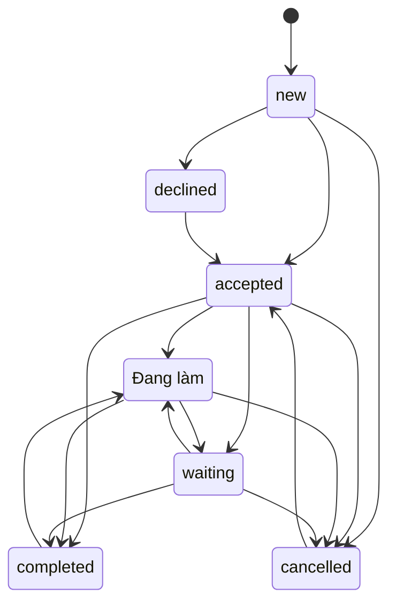

# Tiệm Nhờ Vả — cách dùng và contract

“Tiệm Nhờ Vả — Tích Công Đức. Việc của bạn, công đức của tui!”

Production18/11/2026 dùng API/DB với GitHub login trên website. Route `/requests/`, bản EN `/en/requests/`; request14 giữ URL số cũ, yêu cầu mới dùng detail UUID. [Biên bản Phase5 V1](phase5-release-2026-11-18.md) ghi bằng chứng và giới hạn. Luồng GitHub Issue/archive cũ đã khóa; không dùng labels/comments GitHub để cập nhật nội dung website mới.

## Khách gửi và theo dõi

1. Vào Tiệm, đăng nhập GitHub trong tab hiện tại; phiên giữ khi chuyển trang nội bộ/VI–EN, tải lại hoặc tab mới cần đăng nhập lại.
2. Chọn **Gửi nhờ vả mới**, điền tiêu đề, việc muốn nhờ, kết quả mong đợi, loại, ưu tiên và tags; bấm **Lưu yêu cầu** khi có nhu cầu thật.
3. Chọn **Của tôi** để xem nội dung của mình, gồm nội dung chưa công khai. Chỉ nội dung được owner duyệt mới hiện trên bảng công khai. Gửi yêu cầu hoặc chọn ưu tiên cao không đồng nghĩa đã được nhận việc hay có cam kết thời hạn.
4. Mở detail để theo dõi tiến độ, kết quả và thảo luận. Sửa scope của mình đưa status về new, xóa kết quả hiện tại và cần owner nhận lại; không tự nhận lại chỉ vì approval trước đó còn giữ.

## Owner duyệt và cập nhật

- Đăng nhập rồi vào `/admin/` để xem hàng đợi; phần Requests có danh sách và bộ lọc trạng thái. Owner có thể mở detail từ board hoặc route số cũ.
- Nhập **Nội dung cập nhật / lý do**, chọn **Công khai: approved/rejected/hidden** để quyết định publication. Approved không có nghĩa accepted.
- Chọn **Tiến độ mới**, nhập lý do/thông báo và bấm **Cập nhật tiến độ**. Chỉ owner có quyền này; bảng chuyển trạng thái bên dưới vẫn áp dụng.
- Khi completed phải có **Kết quả hoàn thành** không rỗng. Mở lại công việc xóa kết quả hiện tại nhưng lịch sử vẫn giữ.
- Detail cho phép thêm đính chính gắn ID sự kiện; không sửa/xóa sự kiện cũ. Version/scope conflict cần tải và xem bản mới trước khi tiếp tục.
- Bản import giữ tác giả chưa claim; không cấp quyền tác giả theo tên GitHub. Owner moderation/status là quyền riêng, không tự cấp quyền sửa scope của người khác.

## Lịch sử và giới hạn

Các quy tắc domain ở dưới vẫn được giữ. Đoạn mô tả marker/Issue/worker phía dưới là lịch sử tương thích legacy; luồng production hiện tại là API ở trên. Không tạo dữ liệu mẫu để nâng mức kiểm chứng. Luồng người dùng thật cho tạo/sửa/duyệt mới chưa được gọi là đã kiểm chứng chỉ từ CI hoặc đọc UI.

## Chuyển trạng thái hợp lệ

| Từ | Có thể sang |
| --- | --- |
| new — Chờ tiếp nhận | accepted, declined, cancelled |
| accepted — Đã nhận | in-progress, waiting, completed, cancelled |
| in-progress — Đang làm | waiting, completed, cancelled |
| waiting — Chờ bổ sung | in-progress, completed, cancelled |
| completed — Hoàn thành | in-progress (mở lại) |
| declined — Không nhận | accepted (xem xét lại) |
| cancelled — Đã hủy | accepted (nhận lại) |

Cập nhật owner không hợp lệ bị bỏ qua, ID ghi vào `rejectedUpdates` trong archive, workflow log báo số lượng. Tất cả comment được sắp theo ID và replay từ `new`. Sửa/xóa comment sẽ tính lại cả chuỗi; cập nhật tiếp theo có thể trở nên không hợp lệ nếu mất bước trước. Khi sửa một comment cũ, timestamp hiện ngày chỉnh sửa của comment đó; timeline vẫn theo thứ tự tạo ID. Cách an toàn để mở lại việc hoàn thành là thêm comment mới `in-progress`, không sửa quá khứ. Result hiện tại xóa khi việc được mở lại; kết quả cũ vẫn còn trong timeline.

## Schema v1

| Trường đầu vào | Quy tắc |
| --- | --- |
| title | 3–120 ký tự, trim |
| description | 10–4000 ký tự, trim |
| expectedResult | 3–1000 ký tự, trim |
| category | technology, creative, information, other |
| priority | low, normal, high |
| tags | Tối đa 12, mỗi tag tối đa 40 ký tự, bỏ trùng; không bắt buộc |

Body bắt đầu `<!-- hiens-nha:request:v1 -->` rồi JSON. `submissionUrl()` giới hạn URL 7500 ký tự; form giữ text và báo rút gọn nếu vượt, có thể bổ sung trong GitHub. Update có `status` trong enum, `message` 1–2000 ký tự, `result` tối đa 4000, bắt buộc không rỗng khi completed. Không chạy HTML/MDX từ request/update.

Archive `data/requests/issue-N.json`: `version`, `number`, `approved`, `deleted`, `request`, `status`, `result`, `timeline`, `rejectedUpdates`, `author`, `createdAt`, `updatedAt` và `scopeChangedAt` tùy chọn. Issue number là identity, không dựa vào title. URL issue được dựng từ repository tin cậy + number, không dùng URL tùy ý do khách nhập.

## Thay đổi phạm vi sau khi đã gửi

Khi worker phát hiện payload yêu cầu khác bản đã lưu, nó ghi `scopeChangedAt` bằng thời điểm đồng bộ, reset state về new và bỏ các cập nhật owner tạo trước hoặc bằng mốc đó. Vì vậy kết quả cũ không bị gán nhầm cho phạm vi mới. Owner xem lại và thêm accepted rồi cập nhật tiếp bằng comment mới sau mốc đồng bộ. Cơ chế cố ý thận trọng: comment tạo sau lúc khách sửa nhưng trước lúc worker phát hiện cũng cần gửi lại. Sửa comment tiến độ không đổi phạm vi request. Approval label vẫn giữ publication, không tự nhận lại việc. Nội dung ngoài payload JSON được xem là thảo luận, không sửa scope canonical.

## Thu hồi, phục hồi, giới hạn

- Gỡ approval hoặc xóa marker: lần build kế tiếp bỏ request khỏi board và không tạo detail route. Request bị xóa: tombstone `deleted:true`, request null, timeline rỗng. Không xóa Git history.
- Workflow luôn đọc state mới nhất, lấy hết các trang comment. API lỗi thì không ghi archive mới, snapshot website cũ còn nguyên. Chạy lại Actions → Archive guestbook → Run workflow với issue number.
- Chủ repository là phần trước dấu `/` trong `GITHUB_REPOSITORY`. Chuyển sang organization cần một quyết định mới về operator allowlist; không tự coi mọi collaborator là người nhận việc.
- Không phân công nhiều người, upload file riêng tư, email, deadline đảm bảo hoặc tự làm công việc được nhờ. Những điều đó là mở rộng tương lai.
